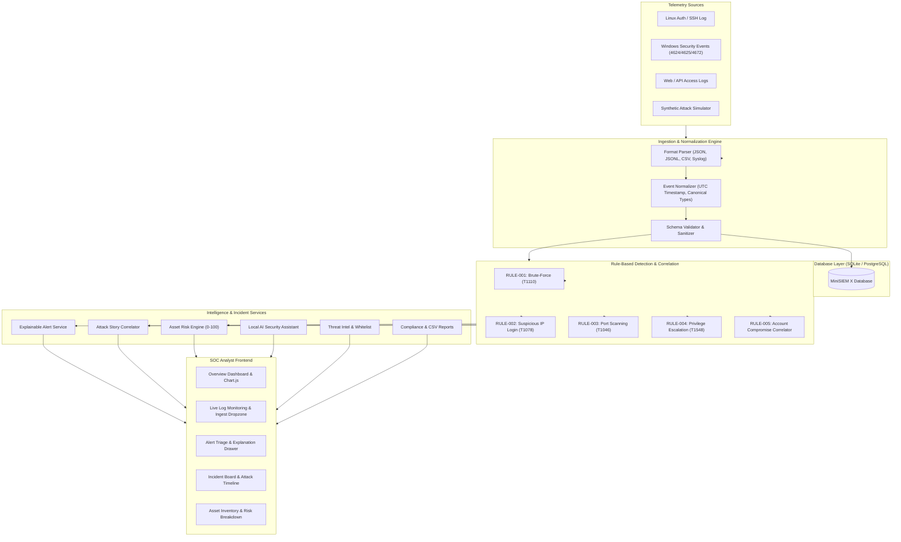

# MiniSIEM X – Intelligent Security Monitoring & Incident Response Platform

> *"See Threats. Understand Risks. Respond Smarter."*

**MiniSIEM X** is a centralized, lightweight, and explainable Security Information and Event Management (SIEM) platform engineered specifically for colleges, startups, small-to-medium businesses, and resource-constrained organizations.

Built with a modular Python FastAPI backend and a dark cyber SOC (Security Operations Center) console, MiniSIEM X ingests, normalizes, detects, correlates, and explains threats across Linux, Windows, and Web Application environments without relying on paid APIs or external dependencies.

---

## 1. Problem Statement

Traditional commercial SIEM platforms (Splunk, Microsoft Sentinel, IBM QRadar) suffer from:
1. **Exorbitant Licensing and Data Volume Costs**: Prohibitive pricing per gigabyte ingested.
2. **Steep Operational Complexity**: Demands dedicated query-language specialists (e.g. SPL, KQL).
3. **The "Black Box" Alert Problem**: Alerts notify analysts *that* an issue exists, but provide zero structured explanation of *why* it is suspicious or *how* to investigate.
4. **Disjointed Incident Overload**: Multiple related log failures flood the queue rather than unifying into a cohesive multi-stage Attack Story.

---

## 2. Proposed Solution

MiniSIEM X addresses these gaps by delivering:
- **Zero Cost & Local Independence**: Runs entirely locally on SQLite (modularly swappable for PostgreSQL) with zero paid cloud API requirements.
- **Universal Multi-Source Normalization**: Standardizes Linux, Windows, Web, and CSV logs into a unified Common Event Schema.
- **Autonomous Explainable Alerts**: Every triggered detection generates structured answers to *What happened?*, *Why is it suspicious?*, *Which rule triggered?*, and *What should the analyst investigate next?*
- **Correlated Attack Story Timelines**: Connects brute force attempts, subsequent valid logins, and privilege escalations into a single CRITICAL Incident.
- **Deterministic AI Security Assistant**: Provides context-aware incident summaries and triage assistance using actual telemetry.
- **Explainable Mathematical Asset Risk Scoring**: Ranks crown-jewel systems based on criticality, active alerts, and unresolved incidents.

---

## 3. High-Level Architecture



---

## 4. Key Platform Features

### Feature 1: Explainable Security Alerts (Unique Differentiator)
Every generated alert includes structured, evidence-backed narrative blocks:
- **What happened?**: Precise quantity of attempts, target user, source IP, and observation window.
- **Why is it suspicious?**: Explains anomaly thresholds (e.g. rapid failure rates characteristic of automated credential stuffing).
- **Triggered Rule & MITRE Tag**: Rule ID, category, and direct technique link.
- **Telemetry Evidence**: Raw timestamps, port lists, and service context.
- **Actionable SOP Checklist**: 4-step investigation playbook for the analyst.

### Feature 2: Attack Story & Event Correlation
Rather than creating 6 disconnected tickets for brute-force attempts and logins, Rule 5 correlates the multi-stage attack chain:
```
[10:00:01] Reconnaissance / Credential Access -> 5 SSH authentication failures
[10:01:15] Initial Access / Compromise      -> Successful authentication gained from same IP
[10:02:18] Privilege Escalation             -> Sudo execution executed as root
```
All events are rendered chronologically in an interactive Attack Story timeline drawer.

### Feature 3: MITRE ATT&CK Mapping
Built-in mappings for supported rules:
- **T1110**: Brute Force (Credential Access)
- **T1078**: Valid Accounts (Initial Access / Persistence)
- **T1046**: Network Service Discovery (Discovery)
- **T1548**: Abuse Elevation Control Mechanism: Sudo and Sudoers (Privilege Escalation)
- **T1059**: Command and Scripting Interpreter (Execution)

### Feature 4: Local AI Security Assistant
An integrated SOC assistant accessible via floating button or drawer:
- Deterministic and operates offline with zero paid API keys.
- Answers questions about open incidents, MITRE techniques, and forensic recommendations.
- Architecture ready for local LLMs (e.g., Ollama / Llama 3) via drop-in adapter.

### Feature 5: Explainable Mathematical Asset Risk Scoring
Assets are scored from **0.0 to 100.0** using a clear, auditable formula:
$$\text{Score} = \min\left(100, \text{Base Criticality} \times 0.25 + \text{Alert Points} + \text{Open Incident Multiplier}\right)$$
- Criticality baseline: Low (10), Medium (25), High (50), Critical (75)
- Alert Points: Critical (+30), High (+20), Medium (+10), Low (+5)
- Open Incidents: +25 points per active unresolved compromise

### Feature 6: Synthetic Attack Simulator (Hackathon Demo Mode)
A dedicated **START ATTACK SIMULATION** control panel with 6 interactive scenarios:
1. Normal Login Activity (authorized baseline)
2. SSH Brute-Force Password Spraying (RULE-001)
3. Suspicious External IP Login (RULE-002)
4. Network Port Scan Sweep (RULE-003)
5. Sudo Privilege Escalation (RULE-004)
6. Full Account Takeover & Compromise Chain (RULE-005)

When executed, synthetic events pass through the live ingestion pipeline, creating genuine alerts and incidents. A single-click **Purge Demo Telemetry** button cleans up demo data while preserving real logs.

---

## 5. Technology Stack

- **Backend**: Python 3.11+, FastAPI, Pydantic V2, SQLAlchemy 2.0
- **Database**: SQLite 3 (modular and PostgreSQL-ready)
- **Frontend**: HTML5, CSS3, Vanilla JavaScript (ES6+)
- **Visualizations**: Chart.js 4.x
- **Icons & Fonts**: Font Awesome 6.5, Inter, JetBrains Mono
- **Testing**: Pytest, FastAPI TestClient, HTTPX

---

## 6. Directory Structure

```
minisiemx/
├── backend/
│   ├── collectors/              # Safe read-only log collectors (Linux, Windows, Web, File)
│   ├── detection/               # Rule-based threat detection & correlation
│   ├── processors/              # Format parser, normalizer, and validator
│   ├── routes/                  # FastAPI endpoints (auth, logs, alerts, incidents, etc.)
│   ├── services/                # Business logic (explanation, risk, reports, assistant)
│   ├── utils/                   # Security (bcrypt, JWT), timestamps, helpers
│   ├── config.py                # Configuration and environment thresholds
│   ├── database.py              # SQLAlchemy engine, sessionmaker, schema seeding
│   ├── main.py                  # FastAPI application entry point
│   ├── models.py                # Database models
│   └── schemas.py               # Pydantic request/response schemas
├── frontend/
│   ├── html/                    # 12 SOC pages (dashboard, logs, alerts, incidents, etc.)
│   ├── css/                     # Dark SOC CSS stylesheets (global, dashboard, alerts, etc.)
│   └── js/                      # Modular vanilla JS controllers (dashboard, logs, api, etc.)
├── data/
│   ├── database/                # SQLite persistent database storage
│   └── sample_logs/             # Realistic sample JSONL datasets (Linux, Windows, Web)
├── tests/                       # Automated test suite (parser, detection, alerts, API)
├── requirements.txt             # Python dependencies
├── run.py                       # One-command startup script
├── .env.example                 # Example environment variables
└── README.md                    # Project documentation
```

---

## 7. Installation & Quickstart

### Prerequisites
- Python 3.10+ installed
- Git

### Step 1: Clone or Navigate to the Workspace
```bash
cd minisiemx
```

### Step 2: Install Dependencies
```bash
pip install -r requirements.txt
```

### Step 3: Run the Application (Windows Quickstart)

#### Option A: One-Click Batch / PowerShell Launchers
1. **Start the MiniSIEM X Backend & Web Portal**:
   - Double-click `start_backend.bat` (or run `.\start_backend.ps1` / `python run.py`).
2. **Start the Real Windows Security Event Log Collector**:
   - Right-click `start_collector.bat` -> **Run as administrator** (or open an **Administrator PowerShell** and run `.\start_collector.ps1` or `python windows_collector.py`).
   - *Why Administrator?* Windows restricts the **Security** Event Log (`4624`, `4625`, `4672`) to Administrators or members of the `Event Log Readers` local group.

#### Option B: Manual Commands
```powershell
# Terminal 1 (Backend)
.\.venv\Scripts\python.exe run.py

# Terminal 2 (Run as Administrator - Real Windows Event Collector)
.\.venv\Scripts\python.exe windows_collector.py
```
*The database and initial seed data (rules, baseline accounts, assets, log sources) will automatically initialize.*

### Windows Audit Policy Check (Recommended for 4625 Failed Logons)
To ensure Windows logs both successful (`4624`) and failed (`4625`) logon attempts on your laptop, run in an Administrator terminal:
```powershell
auditpol /set /subcategory:"Logon" /success:enable /failure:enable
```

### Live Hackathon Demonstration Checklist
1. **Start Backend**: Run `start_backend.bat` and open [http://127.0.0.1:8000](http://127.0.0.1:8000) -> sign in as `admin` (`Admin@MiniSIEM2026!` or click Quick Demo Login).
2. **Start Real Windows Collector**: Run `start_collector.bat` **as Administrator**. Verify `Log Sources` shows `Windows Event Log Forwarder` as `CONNECTED` with your laptop's hostname.
3. **Verify Real Telemetry**: Open **Live Log Monitoring** — real Windows events (`4624`, `4625`, `4672`) appear with green **REAL** badges (distinct from purple **SIMULATED** badges).
4. **Trigger Real Windows Detections**:
   - **Special Privilege Assignment (`RULE-004` / 4672)**: Open any app as Administrator (UAC prompt) or sign in with an admin account -> `RULE-004` generates a HIGH alert (while noisy `SYSTEM` / `DWM-*` / `UMFD-*` OS accounts are suppressed).
   - **Failed Logon / Brute-Force (`RULE-001` / 4625)**: Trigger 5+ failed local login attempts within 120s (e.g., lock screen wrong password or `runas /user:testdemo cmd` with wrong passwords) -> `RULE-001` triggers a HIGH alert scoped to your laptop's hostname.
   - **Account Compromise Incident (`RULE-005`)**: 3+ failed `4625` attempts followed by a real `4624` success for the same user on the same host automatically creates a CRITICAL Incident with linked events in **Incident Management**. You can also click **Create Incident** inside any alert drawer.
5. **Fallback / Network Rules (`RULE-002`, `RULE-003`)**:
   - Single-laptop local logons (`127.0.0.1` / `::1` / missing IP) intentionally do **not** trigger `RULE-002` (Suspicious External IP) to prevent false alarms; demonstrating `RULE-002` with real logs requires a remote logon (`RDP`/`SMB`) from another IP, and `RULE-003` (Port Scan) requires firewall/network probe logs. Use **START ATTACK SIMULATION** on the dashboard for clearly badged **SIMULATED** demos of `RULE-002` / `RULE-003`.

### Step 4: Access the Application
- **SOC Web Portal**: [http://127.0.0.1:8000](http://127.0.0.1:8000)
- **Interactive Swagger API Docs**: [http://127.0.0.1:8000/docs](http://127.0.0.1:8000/docs)
- **ReDoc API Documentation**: [http://127.0.0.1:8000/redoc](http://127.0.0.1:8000/redoc)

---

## 8. Demo User Credentials (Role-Based Access)

| Role | Username | Default Password | Description |
|---|---|---|---|
| **Super Admin** | `admin` | `Admin@MiniSIEM2026!` | Full configuration, triage, and purge rights |
| **Security Admin** | `secadmin` | `SecAdmin@2026!` | Detection rule tuning and whitelist management |
| **Security Analyst** | `analyst` | `Analyst@2026!` | Alert triage, incident response, and investigation |
| **Viewer / Auditor** | `viewer` | `Viewer@2026!` | Read-only compliance report access |

*Quick-fill buttons are provided on the login page for demo convenience.*

---

## 9. Key API Endpoints

### Authentication
- `POST /api/auth/login` – Authenticate session and receive JWT token.
- `GET /api/auth/me` – Current authenticated user details.
- `POST /api/auth/logout` – Invalidate active session.

### Telemetry & Ingestion
- `POST /api/logs/ingest` – Ingest single event through normalizer and detection engine.
- `POST /api/logs/batch` – Ingest list of events in a single transaction.
- `POST /api/logs/upload` – Multipart upload of JSON, JSONL, or CSV log files.
- `GET /api/logs` – Filtered and paginated query of normalized events.

### Threats & Incidents
- `GET /api/alerts` – Filtered security alerts (status, severity, search).
- `GET /api/alerts/{id}` – Alert details with full explanation and SOP.
- `PATCH /api/alerts/{id}` – Update triage status (OPEN, INVESTIGATING, RESOLVED, FALSE_POSITIVE).
- `GET /api/incidents` – List security incidents.
- `GET /api/incidents/{id}/timeline` – Retrieve chronological Attack Story timeline.
- `PATCH /api/incidents/{id}` – Update incident status, notes, or assignment.

### Dashboard & Analytics
- `GET /api/dashboard/stats` – Real-time KPI counts, severity breakdown, and risky assets.
- `GET /api/dashboard/timeline` – Combined activity feed of recent alerts and incidents.
- `GET /api/reports/summary` – Executive summary metrics and recommendations.
- `GET /api/reports/export` – Downloadable CSV export of detected alerts.

### Simulator & AI Assistant
- `POST /api/simulation/start` – Execute synthetic attack scenarios.
- `POST /api/simulation/reset` – Cleanly purge simulated data.
- `POST /api/assistant/chat` – Query the deterministic local security assistant.
- `GET /api/assistant/mitre` – Full MITRE ATT&CK technique reference catalog.

---

## 10. Automated Testing

MiniSIEM X includes a comprehensive automated test suite covering log parsing, normalization, detection rules, alert lifecycles, and API endpoints.

Execute the test suite using pytest:
```bash
python -m pytest -v tests
```

**Test Coverage Summary (21 passed tests):**
- `tests/test_parser.py`: JSON arrays, JSONL, CSV with headers, and empty string handling.
- `tests/test_normalizer.py`: UTC timestamps, canonical types, missing fields, and validator rejection.
- `tests/test_detection.py`: Brute Force (RULE-001), Suspicious Login (RULE-002), Port Scanning (RULE-003), Privilege Escalation (RULE-004), Account Compromise Correlation (RULE-005).
- `tests/test_alerts.py`: Alert lifecycle, deduplication cooldowns, explainable text generation, incident timeline assembly, and asset risk scoring.
- `tests/test_api.py`: FastAPI endpoints for auth, logs ingest, query filters, dashboard stats, reports export, and simulation runner.

---

## 11. Security Limitations & Boundaries

1. **Local Demonstration Storage**: Uses SQLite by default. For multi-terabyte enterprise ingest, configure `DATABASE_URL` in `.env` to point to a high-concurrency PostgreSQL cluster.
2. **Safe Read-Only Collectors**: Collectors parse file feeds and incoming HTTP payloads. They do not inject destructive kernel hooks or unauthorized system taps.
3. **Local Reputation Scope**: The threat intelligence module includes a deterministic local intelligence dataset and whitelist. It does not require paid external VirusTotal or AbuseIPDB API keys out of the box.

---

## 12. Future Roadmap

- **Log Forwarder Agent**: Lightweight Go or Rust agent for cross-platform endpoint streaming (Syslog / WinLogon).
- **PostgreSQL / TimescaleDB Partitioning**: Time-series partitioning for petabyte-scale event archives.
- **Local LLM Integration**: Direct Ollama adapter support for natural language query generation over raw logs.
- **Automated SOAR Webhooks**: Automated containment actions (Slack/Discord alert webhooks, AWS Security Group isolation).

---

## 13. License

Developed for educational, hackathon, and security evaluation purposes under the **MIT License**.

